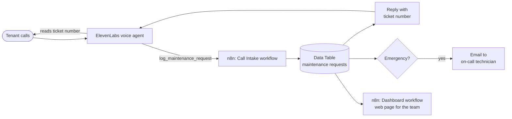

# Growlyze AI Maintenance Intake Agent

**By Growlyze: AI automation for property managers.**

A 24/7 AI voice agent that answers tenant maintenance calls, collects every detail a technician needs, sorts each request by urgency, logs a ticket, and alerts the on-call technician the moment there's an emergency. Property managers follow every request on a live dashboard.

**Built with:** ElevenLabs Agents · n8n · n8n Data Tables · Gmail

---

## The problem

Property managers lose time and money on maintenance calls:

- **After-hours calls go to voicemail.** A burst pipe at 2 a.m. becomes a flooded unit by morning.
- **Messages are incomplete.** "Something's leaking, call me back" means a second call before anyone can act.
- **Everything looks equally urgent.** A dripping tap and a gas smell land in the same inbox.
- **Staff spend hours retyping** voicemails into a tracker.

## What this system does

| | |
|---|---|
| 📞 **Answers every call, 24/7** | No voicemail, no hold music |
| 🚨 **Puts safety first** | Fire, gas and flooding get safety instructions before any questions |
| 📝 **Collects complete details** | Name, callback number, address, unit, issue, access permission, pets, preferred time |
| 🔺 **Sorts by urgency** | `emergency` / `urgent` / `routine`, with clear rules and the higher level picked when unsure |
| 🗂️ **Logs it automatically** | Every request becomes a ticket in an n8n Data Table |
| 📧 **Alerts on-call staff instantly** | Emergencies trigger an email with everything the technician needs |
| 🎫 **Confirms with a ticket number** | The tenant hangs up knowing exactly what happens next |
| 📊 **Live dashboard** | Open requests, urgency counts, search, filters and one-click status updates |

## How it works



### Call flow

1. **Safety check:** the first message asks about fire, gas or flooding, so real emergencies get handled in the first seconds.
2. **Intake:** the agent asks one question at a time and skips anything the tenant already said.
3. **Triage:** it classifies the issue (plumbing, electrical, HVAC, appliance, pest, lockout/security, structural, other) and its urgency.
4. **Log:** it calls the `log_maintenance_request` tool. n8n saves the ticket and returns a ticket number such as `MR-4K9ZQ`.
5. **Close:** it reads back the ticket number and the expected response time for that urgency level.

See a full example in [docs/sample-call.md](docs/sample-call.md).

### Urgency rules

| Level | Examples | Tenant is told |
|---|---|---|
| **Emergency** | Fire/smoke, gas smell, flooding, sewage backup, no heat in freezing weather, live wires, unit can't be locked | On-call tech alerted now; callback within 30 minutes |
| **Urgent** | No hot water, fridge not cooling, only toilet broken, AC out in extreme heat | Team calls first thing in the morning |
| **Routine** | Dripping tap, loose cabinet, light fixture, minor pests | Team calls within 1–2 business days |

## Repository structure

```
├── agent/
│   ├── system-prompt.md                  # Agent instructions: persona, safety, intake, triage, rules
│   ├── elevenlabs-agent.json             # ElevenLabs agent settings (first message, voice, LLM)
│   └── tools/
│       └── log-maintenance-request.json  # ElevenLabs webhook tool the agent calls
├── dashboard/
│   ├── dashboard.html                    # Dashboard page (staff + admin views) served by n8n
│   └── login.html                        # Password login page
└── docs/
    └── sample-call.md                    # Example conversation + what happens behind the scenes
```

## n8n workflows

Both workflows run on the Growlyze n8n instance.

| Workflow | What it does |
|---|---|
| **Growlyze Maintenance Agent - Call Intake** | `POST /webhook/growlyze-maintenance-intake`. Checks the `x-growlyze-key` header, builds the ticket, saves it to the `growlyze_maintenance_requests` Data Table, replies to the agent with the ticket number, and emails the on-call technician for emergencies. |
| **Growlyze Maintenance Agent - Dashboard** | `GET /webhook/growlyze-maintenance/dashboard` shows the login page, then the dashboard. `POST .../login` checks the password, `GET .../logout` signs out, and `POST .../update-status` saves status changes for logged-in users. |

### Dashboard access

The dashboard has two passwords:

- **Dashboard login:** opens the tickets, where staff can change each ticket's status.
- **Activity log:** opens only with its own activity log password (checked in n8n before any log data is sent). It shows one timeline of every call received (from ElevenLabs call history), ticket created, emergency email sent or not sent, and status change. It can be viewed by day, month or year, with totals for the period and a recording link for each call.

Tickets created, email results and status changes are stored in the `growlyze_activity_log` Data Table. Calls are read live from ElevenLabs using the `ElevenLabs API (Growlyze)` credential in n8n.

A login lasts 12 hours. The intake key, the passwords and the session tokens are secrets kept in n8n and ElevenLabs only. Never commit them to this repo.

**Changing a password:** click **Change password** on the dashboard, choose *Dashboard login* or *Activity log*, and enter the current password and the new one (at least 8 characters). Passwords are stored only as salted SHA-256 hashes in the `growlyze_dashboard_settings` Data Table, and every change is recorded in the Activity log. People who are already logged in stay logged in until their 12-hour login ends.

## Setup for a new client

1. **n8n:** in the Call Intake workflow, connect the Gmail account and set the on-call technician's email in **Email On-call Technician**.
2. **ElevenLabs tool:** create a webhook tool from `agent/tools/log-maintenance-request.json`. Set the URL to your n8n host and the `x-growlyze-key` header to the intake key.
3. **ElevenLabs agent:** create an agent with the settings in `agent/elevenlabs-agent.json`. Paste `agent/system-prompt.md` into the system prompt, replace `{{COMPANY_NAME}}`, and attach the tool.
4. **Phone number:** import a Twilio number into ElevenLabs, assign the agent, and point the property manager's after-hours line to it.
5. **Test:** call it with a routine request and an emergency. Check that the ticket appears on the dashboard and the emergency email arrives.

## Customizing for a client

- **Branding:** company name, agent name and voice. Tenants hear the client's company name, not Growlyze.
- **Response times:** match the promises in the urgency table to the client's real SLAs.
- **Where tickets go:** add AppFolio, Buildium, Airtable, HubSpot or Google Sheets alongside the Data Table. Only the n8n intake workflow changes.
- **Escalation:** add SMS or a phone call, or a backup technician if the first doesn't acknowledge.
- **Languages:** ElevenLabs supports multilingual voices for non-English tenants.

## About Growlyze

Growlyze builds, deploys and runs this agent for property management companies. The agent answers tenant calls under each client's own company name, and Growlyze handles setup, hosting, monitoring and changes.

Want this agent for your properties? Get in touch with the Growlyze team.
